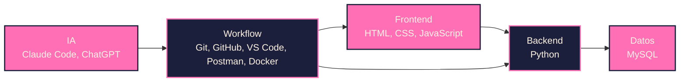

<div align="center">
  
</div>
<div align="center">
  
</div>

<div align="center">

[](https://github.com/ArrivillagaDAS)
[](https://github.com/ArrivillagaDAS)
[](https://www.linkedin.com/in/angela-arrivillaga-4290aa425)
[](https://arrivillagadas.github.io/portafolio_angela-arrivillaga/)

</div>

<br />

## **Sobre mí**
 
**Desarrolladora Junior en formación** | Guatemala, Guatemala | Disponible para prácticas
 
Estudiante de Desarrollo de Software, enfocada en construir interfaces claras, accesibles y funcionales. Mi formación abarca HTML, CSS, JavaScript, Python y bases de datos relacionales, con un interés particular en el desarrollo de videojuegos y experiencias interactivas. Trabajo con código ordenado, mantenible y bien documentado.
 
> Busco mi primera oportunidad profesional como desarrolladora para aportar valor a un equipo, seguir aprendiendo y crecer técnicamente.
 
<br />

## **Qué hago**
 
<table>
  <tr>
    <td width="50%">
      <h3>Frontend</h3>
      <p>Desarrollo interfaces interactivas y dinámicas, centradas en la experiencia de quien las utiliza.</p>
    </td>
    <td width="50%">
      <h3>Proyectos y soluciones</h3>
      <p>Llevo proyectos desde el concepto hasta el resultado final, equilibrando creatividad y funcionalidad.</p>
    </td>
  </tr>
  <tr>
    <td width="50%">
      <h3>Trabajo técnico</h3>
      <p>Escribo código limpio y con lógica sólida, cuidando la calidad de cada componente.</p>
    </td>
    <td width="50%">
      <h3>Aprendizaje continuo</h3>
      <p>Me actualizo de forma constante y convierto cada reto en una nueva competencia técnica.</p>
    </td>
  </tr>
</table>
<br />

## **Stack técnico**
 
<div align="center">
  
</div>

<br />

```yaml
frontend:  HTML, CSS, JavaScript
backend:   Python
databases: MySQL
tools:     Git, GitHub, VS Code, Postman, Docker
ai:        Claude Code, ChatGPT, prompt engineering
```
 
<br />

## **Arquitectura de mis soluciones**
 

 
<br />

## **Estadísticas de GitHub**
 
<div align="center">
  
</div>

<div align="center">
  
  
</div>

<div align="center">
  
</div>

<div align="center">
  
</div>

<br />

## **Cómo trabajo**
 
```txt
Análisis -> estructura -> desarrollo -> validación -> documentación -> mejora
```
 
<table>
  <tr>
    <td><strong>Orden técnico</strong></td>
    <td>Aplico un proceso definido en cada proyecto: analizo, planifico y construyo de forma incremental, asegurando que cada etapa quede completa.</td>
  </tr>
</table>
<br />

## **Aprendiendo actualmente**
 
- MySQL
- N8N
- Postman
<br />

## **Contacto**
 
<div align="center">
  <a href="https://www.linkedin.com/in/angela-arrivillaga-4290aa425">
    
  </a>
  <a href="mailto:sfaaldana101@gmail.com">
    
  </a>
  <a href="https://github.com/ArrivillagaDAS">
    
  </a>
</div>

<br />

<div align="center">
  <strong>Disponible para prácticas | Guatemala, Guatemala | Agosto 2026</strong>
</div>

<br />

<div align="center">
  
</div>
